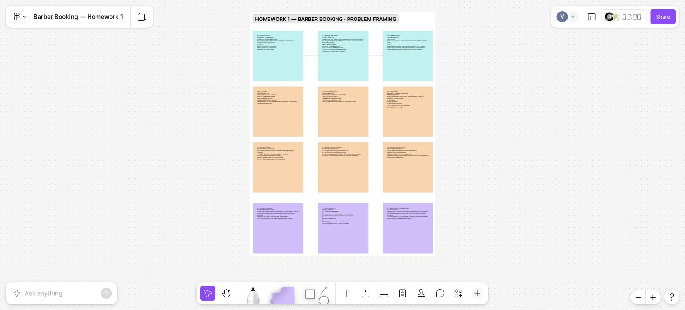

# Homework 1 — Problem framing

## Completed work

Created a separate, visually consistent FigJam revision of the original Barber Booking framing. The board uses 12 native editable sticky notes in a three-column layout, Medium (M) text, teal/orange/violet colors, a labeled section and directional connectors. It preserves the original problem, target users, goals, constraints, riskiest assumption and success criterion.

- [Homework 1 — FigJam submission](https://www.figma.com/board/x66Wm270l3VZomh9uiX5Wo/Barber-Booking-%E2%80%94-Homework-1)
- Sharing verified on 24 November 2026: **Anyone can view**, from the owner's live sharing dialog.
- [Original student-created board — preserved](https://www.figma.com/board/eiKklpUvwx3SQisGTWP1qE/Barber-Booking-%E2%80%94-UX-UI-Project.)
- [Original README before this visual revision](https://github.com/volkan782/ux-ui/blob/7941ad96ed47b0499746e7fd2d3a9b328105f5b1/homework/01/README.md)

## Problem framework

**ASSUMPTION:** Customers who want to book a barber appointment through calls or messages may struggle to find suitable available times and service information, causing delays and uncertainty.

| Element | Initial framing |
| --- | --- |
| User | Barber customers |
| Situation | Arranging a haircut through calls or messages |
| Goal | Choose a suitable appointment |
| Obstacle | Service information and availability are unclear or inaccessible |
| Consequence | Waiting and uncertainty |

This describes a proposed observable booking situation. It is the initial project hypothesis, not a validated research finding.

## User and situation

**ASSUMPTION — target users:** People who regularly visit barbers and want to book conveniently using their phones.

**ASSUMPTION — context:** A customer wants a haircut, checks services and prices, finds a suitable available time and receives clear confirmation without calling the barber.

## Separate goals

| User goals — assumptions | Organization goals — assumptions |
| --- | --- |
| View available services and prices | Reduce booking-related calls and messages |
| Find a suitable appointment time | Reduce scheduling conflicts |
| Book quickly using a phone | Make appointment booking easier |
| Receive clear booking confirmation | Reduce unused appointment slots |

The organization goals are proposed benefits, not measured outcomes.

## Constraints

**Source: proposed project brief/scope, not participant evidence.**

The most important constraint is that the project is a **Figma prototype without a functioning booking backend**. Availability is represented for demonstration and no real appointment is created.

Other proposed constraints: mobile-first design, limited development time and clear representation of available slots.

## Original success criterion

> At least 4 out of 5 test participants should choose a service, select an available appointment time, and confirm their booking within 60 seconds without assistance.

The criterion is unchanged from the original Homework 1 README. It describes observable task completion and an inclusive 60-second limit. This board records the starting target; later test evidence is recorded in the later homework submissions.

## Assumption map and sources

| ID | Claim | Source | Risk / next investigation |
| --- | --- | --- | --- |
| A1 | Customers experience significant difficulties booking through calls/messages | Assumption | **Riskiest:** if false, the main problem may not exist. Investigate real recent booking examples first. |
| A2 | Customers prefer online booking to calls | Assumption | Ask about actual booking methods and reasons. |
| A3 | Customers want to see prices before booking | Assumption | Ask what information they needed and how they found it. |
| A4 | Customers want to find a suitable time quickly | Assumption | Investigate availability selection and delays. |
| A5 | Customers prefer immediate confirmation | Assumption | Ask how confirmation was recognized and remembered. |
| A6 | A clearer booking process will reduce calls, conflicts and unused slots | Assumption; explicit restatement of proposed organization goals | Unmeasured business benefit; no outcome claim. |

The board's source key distinguishes **ASSUMPTION** from **BRIEF/proposed scope**. No initial claim is mislabeled as an observation or an interview result.

## Short visual first pitch

Card 11 presents the original opportunity visually:

Customer wants a haircut → service information and free times are hard to find → waiting/uncertainty → opportunity to make services, availability and confirmation clear.

The first row also uses native arrows to connect the project introduction, problem framework and user/context cards.

## Next step

Investigate how customers currently book barber appointments, what difficulties they experience and what information they want before booking. Challenge A1 first. This is the original next research step leading into [Homework 2](../02/README.md), not a claim that research was performed during Homework 1.

## Official-requirement verification

Checked against the supplied **Homework – Finding an idea and exploring the problem** and **Course Repository** documents on 24 November 2026.

- [x] Separate shareable FigJam link; Anyone can view verified.
- [x] Native sticky notes, arrows and a labeled section.
- [x] Specific problem, affected user and situation.
- [x] Separate user and organization goals.
- [x] Most important constraint and additional scope limits.
- [x] One-sentence user/situation/goal/obstacle/consequence framing.
- [x] Verifiable behavioral success criterion, preserved unchanged.
- [x] Assumption map with sources and the riskiest claim.
- [x] Short visual first pitch.
- [x] Medium (M) sticky text and established pastel visual style.
- [x] Numbered `homework/01/README.md`, week/Neptun frontmatter, verifiable external link and local preview.
- [x] Original board preserved; Homework 2–10 files not edited.

This revision changes presentation and makes the existing framing explicit. It adds no invented research or testing results. Completion here means the deliverable is prepared, not an instructor grading decision.
