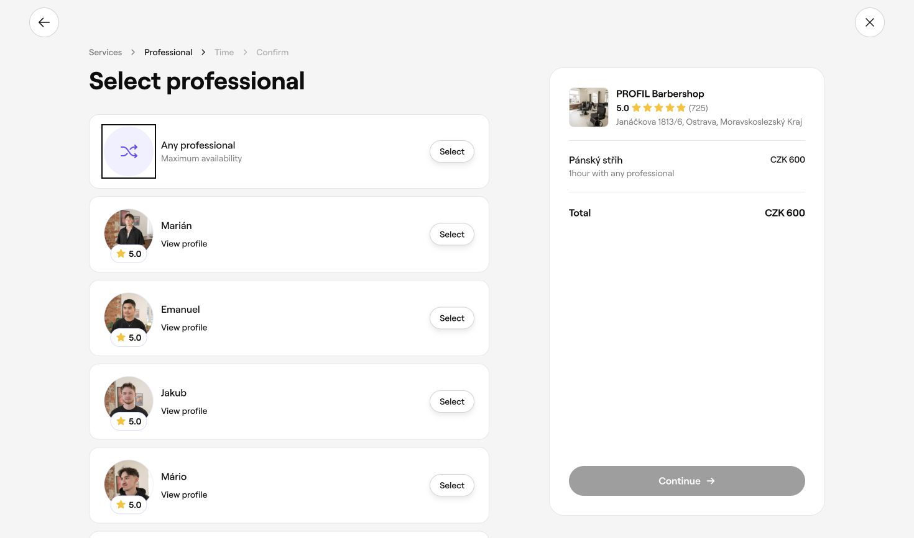
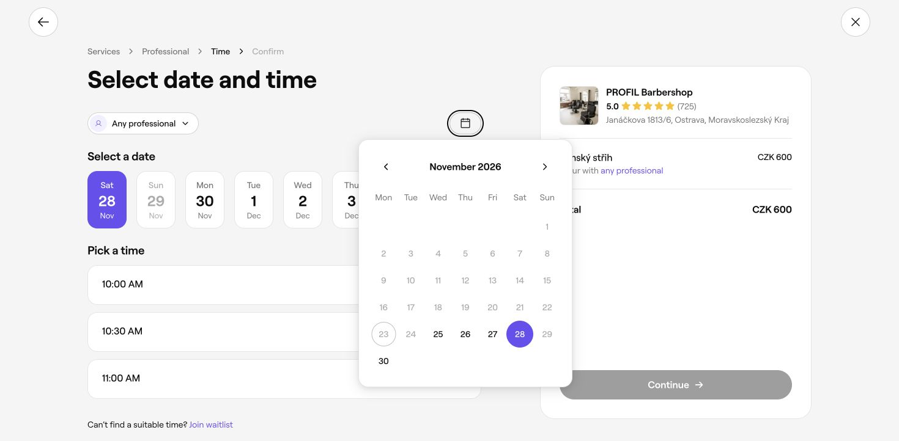
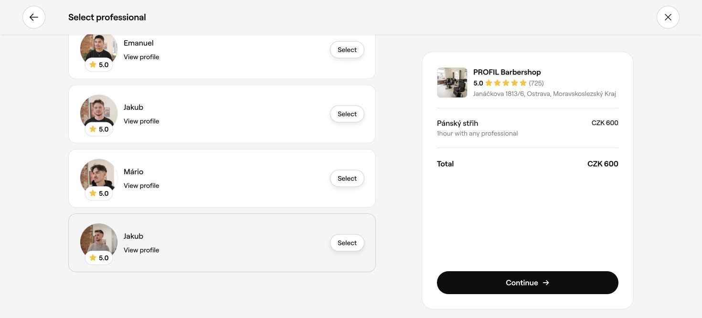
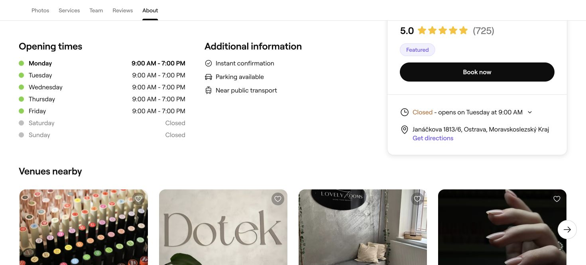
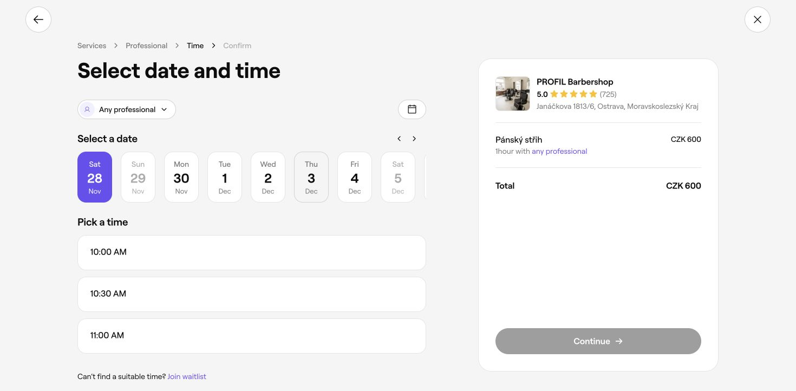
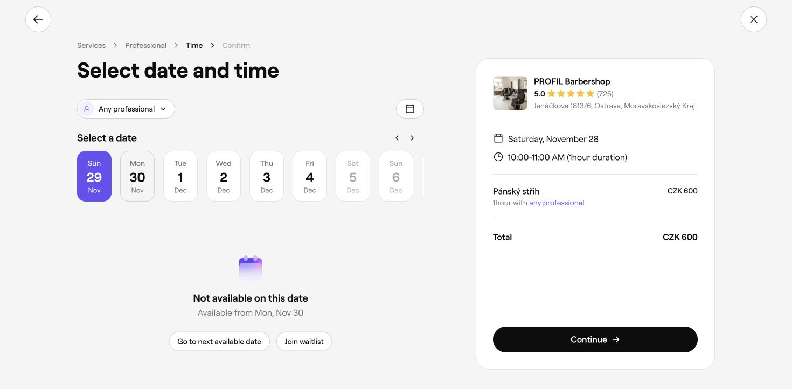

# Homework 3 — Usability and accessibility audit

Audited a competing haircut-booking task, documented six evidence-based findings, checked accessibility manually, reviewed all six interface states, added persona risk hypotheses and three preventive directions for Barber Booking.

**FigJam:** [Barber Booking — Homework 3](https://www.figma.com/board/7t6AUR8c0ErCuqP8IkqZAH/Barber-Booking-%E2%80%94-Homework-3) 

## Scope and method

- **Service:** [Fresha — PROFIL Barbershop, Ostrava](https://www.fresha.com/a/profil-barbershop-ostrava-janackova-1813-6-i85crxim).
- **Task:** choose Pánský střih (men's haircut, CZK 600, 1 hour), professional, date and time, and review the selected appointment before confirmation.
- **For whom:** Homework 2 persona P1, a customer who booked a familiar barber through Instagram, waited for replies, accepted a less suitable time and retained the message confirmation. P1 wants visible availability, price and immediate confirmation.
- **Audit date:** 23 November 2026. Desktop browser, visual inspection, manual keyboard use and DOM/accessibility-semantic inspection.
- No personal information entered, no payment made, no booking submitted. Checkout and cancellation are outside scope.
- These are expert audit observations, not participant usability-test findings. Consequences for P1 and severity are predictions, not measured outcomes.

## Annotated findings

### F1 — Keyboard focus reaches an unnamed control

**Observed:** On the professional step, Tab reaches the circular icon within Any professional. The focused element is a button with no text; its aria-labelledby target is absent, so it has no accessible name. The screenshot captures the keyboard-focus state.

**Manual check:** Start at Go back, then Tab through Close modal → Services → the unnamed circular icon. Inspected the focused element's text, labeling and tabindex. This is a manual keyboard check, not only an automated result.

**Principle:** WCAG 4.1.2, Name, Role, Value.

**Predicted consequence:** If P1 used assistive technology, the action would be difficult to identify. No disability or assistive-technology use is assumed for P1.

**Improvement:** Remove this redundant icon from the focus order if the enclosing choice already provides the action, or give it an accurate accessible name such as “Choose any professional.”

**Severity:** Medium.

### F2 — Past-date unavailable state lacks semantics

**Observed:** In the November 2026 date picker, past November 1 is visually grey. DOM inspection found a button with disabled=false, no aria-disabled and tabIndex=0, despite a disabled-style class. Clicking November 1 dismissed the picker without changing the selected November 28 date. Keyboard focusability of this particular date was not conclusively verified.

**Principle:** WCAG 4.1.2 / understandable unavailable-state communication. This is an accessibility concern, not a full WCAG conformance determination.

**Predicted consequence:** An assistive-technology user may perceive an unavailable date as actionable without an explanation.

**Improvement:** Expose the correct disabled/unavailable semantics consistently with visual styling; explain why past dates cannot be booked and provide predictable picker interaction.

**Severity:** Medium.

### F3 — Summary implies a choice that still needs selection

**Observed:** Initially on the professional step, the summary already says “1 hour with any professional,” while Continue is disabled. Selecting Any professional enables Continue without changing that summary text. Reproduced from a fresh booking flow.

**Principle:** Nielsen — visibility of system status; consistency and standards.

**Predicted consequence:** P1 may believe the choice is already complete and not understand why progress is blocked.

**Improvement:** Either preselect the default and enable progress consistently, or show “Choose a professional” with a clear selection hint until a choice is made.

**Severity:** Low.

### F4 — Two staff choices have identical text identifiers

**Observed:** Two distinct staff portraits both display Jakub and a 5.0 rating. Both corresponding action buttons are named Select Jakub. No unique text identifier was visible on these cards. This finding concerns the card list; further profile details were not audited.

**Principle:** Nielsen — recognition rather than recall.

**Predicted consequence:** P1, who trusts a familiar barber, may select the wrong person when names alone do not distinguish the choices. No wrong selection was observed in a participant test.

**Improvement:** Display a surname/initial or other meaningful unique staff identifier, and include it in the accessible button name and booking summary. Do not rely only on portraits.

**Severity:** Medium.

### F5 — Published opening hours conflict with appointment slots

**Observed:** The profile's weekly opening table lists Saturday Closed (E4). The selected haircut nevertheless offers Saturday 28 November slots including 10:00, 10:30 and 11:00 (E3). No exceptional-hours explanation was observed. The cause is unknown; exceptional opening could explain it.

**Principle:** Nielsen — consistency and standards; match between system and real world.

**Predicted consequence:** P1 may doubt whether a shown appointment is valid and return to messaging to confirm it.

**Improvement:** Keep published hours and bookable availability consistent, or explicitly label exceptional opening hours and clarify which information applies.

**Severity:** Medium.

### F6 — Browsed date and retained appointment diverge

**Observed/reproduction:**

1. Select Saturday 28 November, 10:00.
2. Verify the summary shows Saturday 28 November, 10:00–11:00 and Continue is enabled.
3. Browse to Sunday 29 November.
4. Sunday is visually selected and the main area says Not available on this date, but the summary still shows Saturday 28 November, 10:00–11:00 and Continue remains enabled.

The state persisted when checked again. Retaining an earlier slot while browsing may be intentional, but the distinction between the browsed date and selected appointment was not clearly communicated. Continue was not pressed after this state, so checkout behavior and any actual wrong booking are unverified.

**Principle:** Nielsen — error prevention; visibility of system status.

**Predicted consequence:** P1 could continue with an unintended date while expecting the currently highlighted date.

**Improvement:** Either clear the old slot when the date changes and disable Continue until a valid slot is selected, or explicitly announce the retained appointment and clearly distinguish browsing from selection.

**Severity:** High potential impact; no measured frequency or observed booking failure.

## State review

| State | Observed evidence | Assessment / next check |
| --- | --- | --- |
| Normal | Services, professionals and available slots; prices, duration and step indicator visible | Present; F3–F5 identify ambiguity in otherwise usable steps |
| Loading | No reliable loading capture | Unknown, not evidence of a missing state; verify later |
| Empty | November 23 Fully booked; November 29 Not available; next availability and waitlist offered | Present; F6 shows weak communication when an earlier slot is retained |
| Error | No server or validation error deliberately triggered | Unknown; do not invent an error or claim it is absent |
| Success | No booking submitted | Not observed; final confirmation remains outside audit scope |
| Disabled | Continue before professional selection; visually unavailable past dates | Present; F2 semantics and F3 explanation are weak |

## Deceptive patterns

No deceptive pattern was established in the inspected steps. Checkout costs, cancellation, payment and consent were not assessed, so this is not a claim about the entire service. F3/F6 are documented as status/error-prevention problems without attributing deceptive intent.

## Homework 2 persona — audit-derived risk addendum

Keep all original P1 interview facts and the original Homework 2 artifact unchanged. Add the following **design risk hypotheses** for subsequent work:

- Conflicting hours and availability may undermine booking certainty (F5).
- Browsed date versus retained slot may undermine confidence in the confirmation (F6).
- Duplicate staff identifiers may make finding a familiar barber harder (F4).
- Accessible action names and unavailable-state semantics are necessary for inclusive use (F1/F2); P1's disability or device characteristics remain unknown.

**What changed and why:** Added potential risks exposed by the competitor audit to guide design. No new user need was claimed as an interview finding, and no demographic, disability, interview answer or testing result was invented.

## Three risks for Barber Booking's main task

| Risk | Preventive direction |
| --- | --- |
| R1 — Wrong appointment date/time | Synchronize date, slot and summary; clear invalid slots or explicitly announce retained selection; prevent progress without a valid appointment |
| R2 — Inaccessible booking controls | Provide accessible names, semantic disabled states, visible keyboard focus and understandable feedback; manually check the complete keyboard route in later prototypes |
| R3 — Wrong barber choice | Use unique visible and accessible staff identifiers on cards and summary; do not depend on portraits alone |

These are future design directions, not claims of implemented or tested features. Homework 1's target—4 of 5 participants complete service/time/confirmation unaided within 60 seconds—remains unchanged and untested.

## Verification against official Homework 3 requirements

- [x] Separate shareable FigJam link, with anyone-can-view access verified.
- [x] Examined service, task, purpose and persona described.
- [x] Six observable annotated findings, each with screen evidence, principle, persona consequence and improvement direction.
- [x] At least two accessibility findings (F1/F2).
- [x] At least one manual accessibility check (F1 keyboard sequence).
- [x] Deceptive-pattern review documented with clear scope limits; none established.
- [x] Normal, loading, empty, error, success and disabled states reviewed; unknown states explicitly distinguished from missing states.
- [x] Conditional persona update provided as an audit-derived risk addendum, without changing the source interview.
- [x] Exactly three own-project risks with preventive directions.
- [x] Numbered homework folder, README frontmatter and verifiable external results, plus six original screenshot files.
- [x] Medium text used for editable sticky notes; separate file and visual-section approach retained.
- [x] Homework 1 and Homework 2 preserved.

This checklist records completion of the specified deliverables, not instructor acceptance or a guaranteed course grade.

## Official sources

- [Homework 3 — Usability and accessibility audit](https://pte-mik.github.io/info/ux-ui-en/content/03/03-00-homework/) (project-source PDF reviewed).
- Course Repository and Assessment and Grading System project-source PDFs reviewed. Completing this homework does not replace the mandatory final project, attendance or written test.
