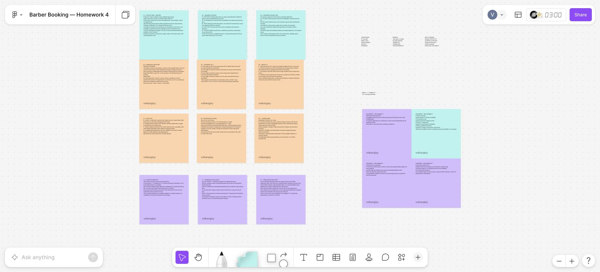

# Homework 4 — Problem definition and opportunity search

**Status:** Deliverables completed and checked against the official assignment; instructor acceptance is separate.

[Barber Booking — Homework 4: separate FigJam board](https://www.figma.com/board/zUSL1U7OCtPFIRDwXQqLzD/Barber-Booking-%E2%80%94-Homework-4) — anyone with the link can view. The Homework 3 layout was duplicated into this new file; all previous homework files remain unchanged. The main 12-card layout, pastel colors and native editable notes are retained. The additional 2×2 matrix and aligned three-column stakeholder table serve this assignment. All 16 sticky notes and editable text use Medium (M).

## One-page project brief

| Field | Brief |
| --- | --- |
| Problem | P1 waits for replies to learn available haircut times, adding coordination to an otherwise successful booking process. |
| Target user | Returning customer of a familiar barber, represented by the single-participant HW2 P1 persona. |
| Primary task | Choose one service and available time, review the appointment details and confirm one haircut appointment. |
| Organizational goal — proposed | Make appointment requests clear with less message coordination. This is a design goal, not a measured business result or a barber-reported need. |
| Constraints | Individual course prototype; one retrospective interview; no live availability/payment backend; accessible controls; real research only. Availability will be simulated and labeled as such. |
| Success criterion — unchanged | At least 4 of 5 participants finish service selection, time selection and confirmation unaided within 60 seconds. This HW1 target remains untested. A 3-person test cannot demonstrate a 4-of-5 result. |
| Exclusions | Payments, cancellations, loyalty, reviews, multi-shop search, and staff scheduling/administration tools. |

This compact brief is also presented as one dedicated card on the FigJam board.

## Stakeholder table

| Stakeholder | Interest / need | Role and influence | Involvement and evidence status |
| --- | --- | --- | --- |
| P1 customer | Suitable time, service/price information and clear confirmation | Research source; informs the task focus | One supplied retrospective interview, HW2 O3–O7; not a usability test or representative sample |
| Barber / shop | Accurate, manageable bookings — assumed | Future operational validator; would determine availability rules | Not interviewed; operational needs and willingness to maintain slots are unverified |
| Student designer | A coherent, researchable and testable booking flow | Designs and documents the prototype and submissions | Responsible for connecting evidence, assumptions and design choices |
| Instructor | Verifiable course deliverables and individual project | Evaluates submitted work | Requirements come from the official homework, repository and assessment PDFs |
| Usability participants | Understandable and accessible booking task | Provide future formative feedback | No sessions or results claimed here |

## Evidence and assumptions — kept separate

### Research evidence

E1 · HW2 O4/O5: Preferred time taken; accepted a later alternative. Waited for replies; could not independently see slots.

E2 · O3: Needed price, times and haircut suitability; knew approximate previous price.

E3 · O6/O7: Message confirmed day/time; chat retained. Trusted barber; overall okay. Website preference reported.

E4 · HW3 F1/F2: Unnamed control and weak unavailable-date semantics observed.

E5 · F4/F5/F6: Duplicate staff names, conflicting hours/slots, browsed date versus retained slot.

E1–E3 are one person's supplied self-report, not observed booking. E4–E5 are expert audit observations, not P1 tests.

See [Homework 2](../02/README.md) for the full anonymous interview and [Homework 3](../03/README.md) for audit reproduction details and screenshots. E1–E5 here are synthesis IDs, not additional participants.

### Unverified assumptions

A1: Customers beyond P1 share these coordination difficulties.

A2: The barber would maintain accurate live availability; no barber interview yet.

A3: Self-service selection plus a clear summary reduces delay and improves certainty.

A4: Proposed controls will be usable and accessible; not yet tested.

A5: Lower coordination benefits shop operations; no business metrics collected.

A6: Matrix impact and feasibility estimates are design judgments, not measured scores.

Do not assume missed appointments, lost confirmations, disability, age or device. No new research/test results are claimed.

## Main-task user story

As a returning barber customer, I want to choose a suitable service and available time and know the appointment is confirmed, so that I can arrange my haircut with confidence and less back-and-forth.

## Problem statement

The problem of the returning barber customer is that available haircut times can only be learned through a reply-dependent message exchange, because of which choosing a suitable appointment requires waiting and extra coordination.

This follows the required user type → situation/obstacle → negative consequence structure. It states a research-derived problem, not a proposed screen or solution. Scope is P1's account (HW2 O4/O5); the current process did succeed and P1 felt okay overall.

## How Might We questions

| ID | Question | Basis |
| --- | --- | --- |
| H1 | How might we help a returning customer find a suitable haircut time with less reply-dependent coordination? | E1 |
| H2 | How might we help the customer understand the service and price before committing? | E2 |
| H3 | How might we help the customer know exactly which appointment is confirmed and retrieve its details? | E3; audit E5 informs error prevention |
| H4 | How might we help the customer recover when their preferred time is unavailable? | E1 |

These questions frame specific needs without prescribing an app, calendar or interface feature.

## Eight candidate ideas

| ID | Idea and short description | Derived from |
| --- | --- | --- |
| I1 | Visible slot picker: choose from labeled available times for one service | H1 |
| I2 | Structured request form: submit preferred windows for the barber to confirm later; reduces free-text ambiguity but retains reply delay | H1 |
| I3 | Service/price card: show service scope, duration and price before selecting a slot | H2 |
| I4 | Guided service questions: short questions help identify a suitable service; adds steps and requires trusted advice | H2 |
| I5 | Review and confirmation summary: explicit service, unique barber, date/time and price, with clear pending/confirmed states | H3 |
| I6 | Booking reference/history: retrieve confirmed details later; adds persistence, identity and privacy considerations | H3 |
| I7 | Nearby available alternatives: offer other labeled dates/times when the preferred slot is unavailable, without silently changing selection | H4 |
| I8 | Availability alert/waitlist: ask to be notified if a slot opens; requires consent, delivery and staff operations | H4 |

These are alternatives and candidate capabilities, not implemented or tested features.

## 2×2 prioritization matrix

**Vertical axis:** estimated impact on P1's main booking task, increasing upward.  
**Horizontal axis:** feasibility in the course prototype, increasing rightward.

| Impact ↑ / Feasibility → | Low feasibility | High feasibility |
| --- | --- | --- |
| High impact | I6 booking reference/history; I8 availability alert/waitlist | I1 visible slot picker; I3 service/price card; I5 review/confirmation; I7 available alternatives |
| Low impact | I4 guided service questions | I2 structured request form |

The FigJam board contains the same four spatial quadrants, explicitly labeled with both axes.

### Placement justification

| Idea | Impact judgment | Feasibility judgment |
| --- | --- | --- |
| I1 | High: directly targets E1's reply-dependent access to slots | High for a simulated prototype; production availability is an unresolved dependency |
| I2 | Lower relative impact: clearer requests still depend on a reply, preserving E1's main pain | High: straightforward form interaction |
| I3 | High: directly supports E2's information needs | High: simple service content and clear decision information |
| I4 | Lower relative impact: limited evidence for extra guidance for this familiar-barber persona | Lower: question logic and reliable advice add design/validation effort |
| I5 | High: supports E3's existing clear confirmation and reduces ambiguity highlighted by E5 | High: explicit review and confirmation states can be prototyped |
| I6 | High potential retrieval value from E3, though no lost booking was reported | Lower: persistence, identity and privacy add scope |
| I7 | High: addresses E1's unavailable preferred time with alternatives | High: a clear alternative-slot/empty-state branch can be prototyped |
| I8 | High potential value for unavailable slots (E1); benefit remains unverified | Lower: consent, notification delivery and staff operations add dependencies |

**A6 applies to every placement:** impact and feasibility are comparative design estimates, not measured scores. High feasibility refers to designing/testing a coherent course prototype, not deploying a production service. Low impact does not mean an idea is useless.

## Direction taken forward and why

Take forward **I3 → I1 → I5**, with **I7** as the unavailable-time recovery branch: service/price → available time → review → explicit confirmation.

This directly addresses availability coordination (E1), needed information (E2) and confirmation clarity that already works in chat (E3). Carry forward accessible names and unavailable-state semantics from E4, and unique staff identifiers plus a synchronized date/slot/summary from E5.

Defer I6 and I8 because they expand persistence, identity, consent, notification and operational dependencies. I2 is easy to prototype but does not remove the reply-dependent wait. I4 lacks a strong need in current P1 evidence and adds guidance assumptions.

This is a design hypothesis, not proof of adoption, reduced waiting or business value. Later work must test task completion/time, understanding of the selected appointment, keyboard interaction and recovery from unavailable slots.

## Official requirement verification

- [x] Separate shareable FigJam link, with Anyone can view verified.
- [x] One-page brief: problem, target user, primary task, organizational goal, constraints, success criterion and exclusions.
- [x] Stakeholder table on the board and in this README.
- [x] Main-task user story.
- [x] Required problem-statement structure, derived from research rather than a solution.
- [x] At least three neutral, focused HMW questions: four provided.
- [x] At least eight solution ideas with short descriptions and HMW links: eight provided.
- [x] Spatial 2×2 impact/feasibility matrix and understandable placement justification.
- [x] Selected direction justified against alternatives.
- [x] Research evidence and unverified assumptions marked separately.
- [x] Medium text on all 16 sticky notes; table columns and matrix label use Medium.
- [x] Existing homework files preserved; numbered homework folder and frontmatter supplied.
- [x] Repository index and individual-project timeline updated; Kanban tracking updated.

## Board preview

## Official sources reviewed

- Homework — Problem definition and opportunity search, supplied project-source PDF ([course page](https://pte-mik.github.io/info/ux-ui-en/content/04/04-00-homework/)).
- Course Repository and Assessment and Grading System, supplied project-source PDFs.

This homework does not replace attendance, the mandatory final project or the written test. Completion of deliverables is not instructor acceptance.
