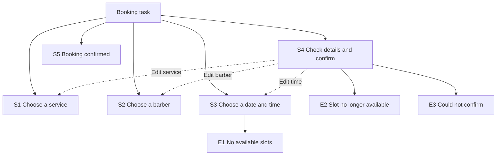
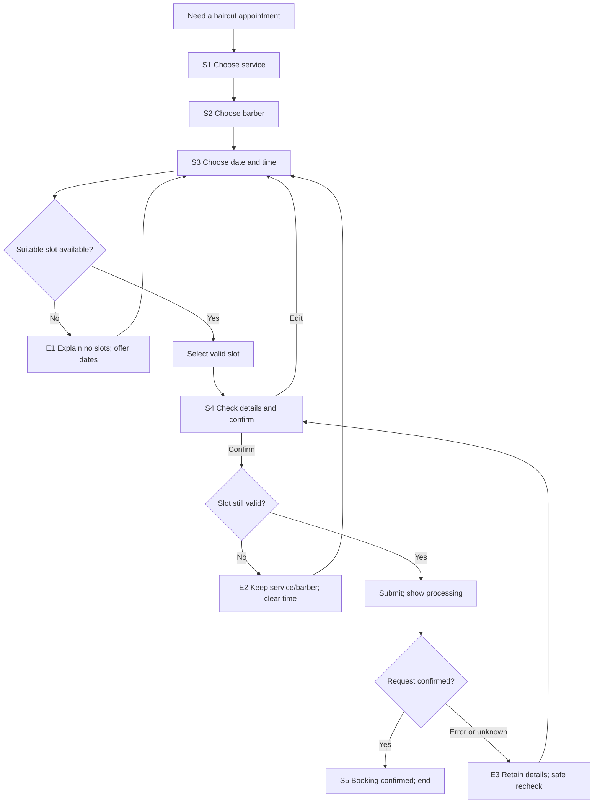
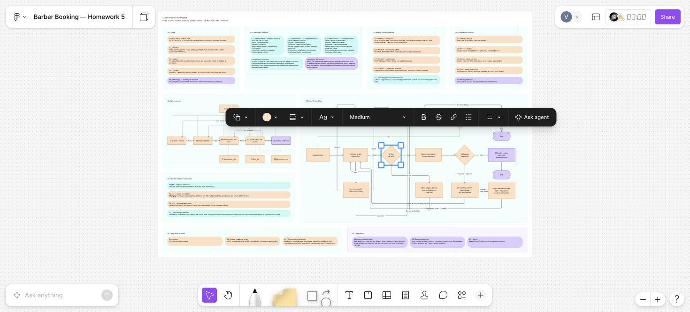

# Homework 5 — Information architecture and user flow

[Separate FigJam board — Barber Booking Homework 5](https://www.figma.com/board/oQf2xsxOAoigLXes83u69L/Barber-Booking-%E2%80%94-Homework-5)

## Scope and evidence

One task: arrange a haircut with a suitable service/barber/time, check details and confirm one appointment. Builds on Homework 4's I3/I1/I5 with I7 recovery. Previous homework artifacts remain unchanged.

HW2 O3–O5 supports visible service/price and available times. O6 shows the existing message confirmation worked. HW3 F1/F2 informs accessible names/states, F4 unique barber identification, and F5/F6 coherent availability and selected-summary information. These are source-specific reports/audit observations, not measured improvements.

## Prioritized content inventory

| Priority | Information / function | Why needed |
| --- | --- | --- |
| 1.1 | Service name/scope, price, duration; select one service | Decision information, HW2 O3 |
| 1.2 | Unique barber identifier or explicit Any available barber; select | Familiar-barber context, O7; avoid ambiguous names, HW3 F4 |
| 1.3 | Selected date, timezone, available time slots, unavailable explanation; choose valid slot | Access to suitable availability, O4/O5 |
| 1.4 | Service, barber, date/time, duration and price; edit/check/confirm | Know exactly what is being booked; HW3 F6 |
| 1.5 | Processing, failed/uncertain outcome and confirmed status | Avoid false confirmation and duplicate actions |
| 1.6 | Confirmed appointment details and reference | Recognizable confirmation, O6; reference is proposed design content |
| 2 | Progress, Back/Edit, alternative slots and understandable errors | Support primary task and recovery |
| 2 | Accessible names, visible keyboard focus, disabled semantics and status feedback | HW3 F1/F2; inclusive prototype design |
| Supporting | Location/address context on confirmation | Expected by label-check L2; proposed supporting content, no extra navigation |
| Excluded | Payment, cancellation/rescheduling, loyalty, reviews, accounts/history, multi-shop search, admin tools | Outside the selected task |

Priority is a design judgment informed by evidence. No live inventory/backend is implemented. The later prototype will label simulated availability and fictional sample appointments.

## Label-comprehension check — three real people

The student supplied the following answers and explicitly stated these were three real people. Use anonymous IDs L1–L3 here to avoid implying they are the earlier interview participant P1. Actual test date, participant background, duration and delivery conditions were not supplied. These are student-supplied written accounts, not independently verified recordings or verbatim quotations.

**Prompt:** What would you expect to do or see under each label? Which labels are confusing? The requested plan was to avoid explaining the intended meanings first; actual facilitation was not independently observed.

| Label checked | L1 supplied answer — summary | L2 supplied answer — summary | L3 supplied answer — summary |
| --- | --- | --- | --- |
| Choose a service | Choose haircut/beard trim | Different haircut options and prices | Haircut, beard or both |
| Choose a barber | See barbers and pick one | Names, perhaps photos | Choose who cuts hair, perhaps any barber |
| Choose a date and time | Pick a day and free time | Calendar with available appointments | Free times fitting schedule |
| Review appointment | Check everything before confirming | Unsure; perhaps previous bookings | Check barber, service, price and time |
| Booking confirmed | Successfully booked | Appointment booked, with time/address expected | Done; expects confirmation message |
| Confusing labels | None reported | Review appointment | None reported |

### Lessons and decisions

- Retain Choose a service, Choose a barber, Choose a date and time and Booking confirmed: supplied interpretations were consistent with the intended task.
- Change **Review appointment → Check details and confirm**: L2 interpreted “Review” as viewing booking history. The new label states both checking and the next action.
- Show explicit success and appointment details on confirmation. Do not treat L3's expected message as proof that email/SMS delivery is required or implemented.
- L2's expectation of photos does not require photos in the low-fidelity wireframe. Unique text identifiers remain necessary.
- **The revised label has not been retested.** This is a small comprehension check, not task usability testing, representative validation, or a measured success rate.

## Main screens and functions

| ID | Label used after the check | Functions / next step |
| --- | --- | --- |
| S1 | Choose a service | Compare scope, price/duration; choose one; Continue to S2 |
| S2 | Choose a barber | Choose uniquely identified staff or explicit Any available barber; Continue to S3 |
| S3 | Choose a date and time | Select date and valid slot; show unavailable explanation/alternatives; Continue to S4 |
| S4 | Check details and confirm | Review complete appointment; edit service/barber/time; Confirm appointment |
| S5 | Booking confirmed | Explicit confirmed success, same details and booking reference |

E1 is a state of S3; E2/E3 are states of S4. They are not extra top-level product destinations. Changing service/barber invalidates incompatible downstream slot choices.

## Sitemap

The scoped root is the booking task, not an invented home/dashboard. Its screen children are S1–S5. Normal sequence is S1 → S2 → S3 → S4 → S5; Edit links return to the relevant step. S5 is shown only following confirmed submission.

## Goal-first task flow

Edit service and Edit barber return to S1/S2 respectively, as shown in the sitemap. Back or stopping leaves no booking. If the submission outcome is unknown, verify status before allowing a retry; do not encourage duplicate bookings. Backend behavior is a proposed design constraint, not implemented infrastructure.

## Three exceptional states and evidence

| State | Trigger | Recovery | Evidence / assumption |
| --- | --- | --- | --- |
| E1 No available slots | Preferred date/time has no bookable option | Explain; offer other dates/times or Back; Continue disabled without valid slot | HW2 O4 preferred time unavailable, O5 reply dependence |
| E2 Slot no longer available | Selected time invalid when confirming | Keep service/barber, clear invalid time; choose another slot in S3 | Changing inventory is an operational assumption; HW3 F5/F6 informs consistency risk; no actual race observed in P1 research |
| E3 Could not confirm | Submission fails or outcome is uncertain | Retain details; clear status and safe retry/recheck; verify unknown outcome before retry | Unverified technical risk, not a reported participant failure or observed outage |

## Homework 6 wireframe selection

Build five mobile main-flow screens S1–S5, including S3 as the central date/time decision screen and S5 confirmation. Work out at least S3-E1 empty and S4-E2 changed-availability states. Provide a larger-screen version of S3. Annotate E3 safe retry behavior, without adding an unnecessary product area.

Use black-and-white simple shapes/placeholders, Auto Layout, traceable frame/layer names, flow references/arrows, assumptions/behavior notes, and a short layout/main-action/content-hierarchy explanation.

The unchanged HW1 success target (4/5 unaided in 60 seconds) remains untested. These label answers do not establish task completion.

## Requirement verification

- [x] Separate shareable FigJam link.
- [x] Prioritized inventory tied to the scoped task.
- [x] Label check with at least three real people; supplied answers and lessons recorded.
- [x] Ambiguous label revised with an explicit rationale; no claim of retesting.
- [x] Sitemap hierarchy/relationships and task access.
- [x] Main screens and functions.
- [x] User-goal start, decisions, normal path and at least three exceptional states.
- [x] Exception evidence distinguished from unverified technical/operational risks.
- [x] Homework 6 screen selection.
- [x] Medium editable FigJam text and visual organization checked before completion.
- [x] Numbered homework README/frontmatter, separate commit, index/timeline and Kanban updated.
- [x] Homework 1–4 preserved.

Completion denotes prepared deliverables, not instructor acceptance. Attendance, final-project acceptance and the written test remain separate course requirements.

## Sources

Official Homework 5, Course Repository and Assessment and Grading System project-source PDFs; [Homework 5 course page](https://pte-mik.github.io/info/ux-ui-en/content/05/05-00-homework/). Research sources are linked above.

## Board preview

