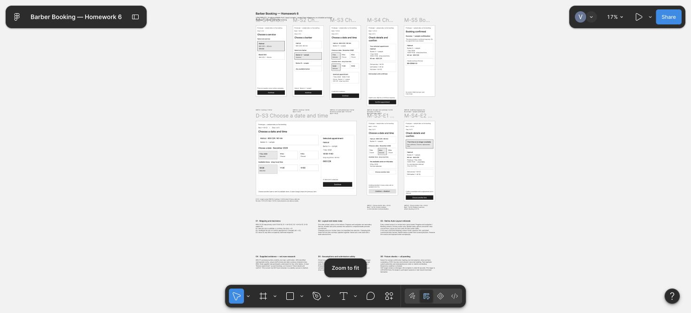
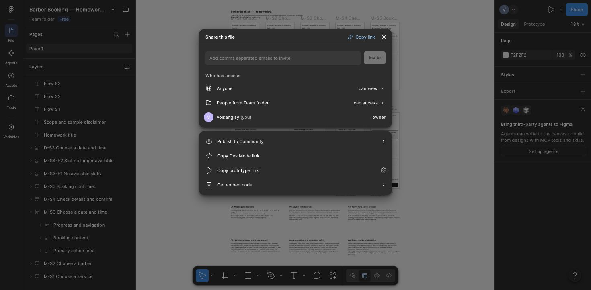

# Homework 6 — Low-fidelity wireframes

**Status: Complete — required deliverables checked.** Sharing was verified on the free Starter team “Barber Booking Coursework”: Anyone can view. The original Figma file key and link were preserved, with all eight screen frames intact. Auto Layout was rechecked after the move. No paid upgrade was accepted. Instructor acceptance is separate.

[Barber Booking — Homework 6: separate Figma Design file](https://www.figma.com/design/HGbsOt8goSXuvxyM3BDZSx/Barber-Booking-%E2%80%94-Homework-6)

Builds directly on [Homework 5's checked labels, sitemap and task flow](../05/README.md). 

## Scope and status

Eight editable grayscale screen frames: five mobile screens for the main task, two critical-state screens and one larger-screen variant of the main date/time decision screen. Native Auto Layout, simple shapes/text, no photos, decorative icons or final color design.

All service prices, barber identities, dates, slots, address placeholders and reference numbers are **fictional prototype content**. Availability is simulated. The prototype does not create real bookings, send messages, collect payment or implement a live backend.

These are wireframes and proposed behaviors, not usability-test results. The supplied three-person label check is documented in Homework 5; the changed label “Check details and confirm” has not been retested. HW1's 4-of-5 unaided completion within 60 seconds remains an untested target.

## Screen and flow mapping

| Figma frame | HW5 screen/state | Purpose and next action |
| --- | --- | --- |
| M-S1 Choose a service | S1 | Compare service scope, price/duration; choose one; Continue → S2 |
| M-S2 Choose a barber | S2 | Choose unique text identity or Any available barber; Continue → S3; Back → S1 |
| M-S3 Choose a date and time | S3 / D1 | Main decision screen: select date and available time, check context/summary; Continue → S4 only with valid slot |
| M-S4 Check details and confirm | S4 / D2 / D3 | Check service/barber/date/time/price; edit relevant step; Confirm → processing, validity check and confirmed response |
| M-S5 Booking confirmed | S5 | Explicit success with matching details and sample reference; end of task |
| M-S3-E1 No available slots | E1 | Empty state: retain service/barber/date, show no times; choose another date → S3; no valid selected time |
| M-S4-E2 Slot no longer available | E2 | Error/changed-inventory state: retain service/barber/price, clear invalid time; Choose another time → S3 |
| D-S3 Choose a date and time | Larger-screen S3 | Same main task/data/action as mobile, with selection area and persistent summary in two columns |

Main sequence: S1 → S2 → S3 → S4 → S5. Screen labels/flow references connect the wireframes to the Homework 5 diagram. A clickable prototype is not claimed; interaction prototyping belongs to the next assignment.

## Critical states

### E1 — no available slots

The date/time screen explains that the chosen date has no available slots. Other dates are offered explicitly. Continue cannot progress without a valid selected time. Service/barber context stays visible; no automatic time substitution is implied.

**Basis:** HW2 O4 preferred time unavailable and O5 reply-dependent coordination. This is a proposed recovery design, not a tested result.

### E2 — slot no longer available

The review screen explains that the earlier selected time is unavailable. It retains service/barber/price, clears or explicitly invalidates the old time, and directs the user back to choose another time. It must not show Booking confirmed.

**Basis:** Changing inventory is an operational assumption; HW3 F5/F6 exposed consistency risks, not an observed booking race.

### E3 — submission uncertainty, annotated behavior

No extra screen is required for the two-state minimum. Annotations specify retaining details, preventing duplicate submission while processing, distinguishing a known failure from an unknown outcome, and verifying status before retry when necessary. Success appears only after a confirmed response. This is an unverified technical risk and proposed behavior, not implemented infrastructure.

## Layout logic, hierarchy and primary action

- Put the user's current task heading and progress first. Back/Edit are secondary navigation.
- Show service scope, price and duration before selecting a time, then keep selected service/barber context visible.
- Give the date and available-time choices the main decision area. The selected appointment summary makes date/slot consistency explicit.
- Put one clear primary action after the relevant content: Continue, Confirm appointment or Choose another time in recovery.
- Check complete details before committing. On success, replace progress/commit emphasis with explicit confirmation and the same details/reference.
- Use simple rectangular controls and grayscale contrast to show hierarchy. No final visual branding, photos or decorative icons are included.

## Native Auto Layout and responsive construction

Inspection confirmed Auto Layout enabled on all 8 frames: seven mobile widths of 390px (heights 900–1020px), and desktop 1280×940px. The expanded S3 Booking content group also has native Auto Layout enabled. E1, E2, confirmation and the mobile/desktop main screen were visually inspected.

Screen frames and their nested content/cards/action rows use native Auto Layout. Naming maps M-/D- variants to HW5 S1–S5 and E1/E2. Content groups, option cards, text and actions are named for their purpose, so the layer structure is traceable.

Mobile screens stack context, choices, summary and primary action. Nested rows group related date/time options and buttons. The larger-screen S3 uses a horizontal main region with selection on the left and a persistent summary/action on the right. Content uses fill/hug behavior as appropriate, rather than relying solely on unrelated absolute coordinates.

Auto Layout is justified by changing text length, repeatable card spacing, keeping actions aligned and supporting the mobile/desktop reflow. A separate desktop composition demonstrates the larger-screen layout; it is not proof that every intermediate viewport has been tested.

## Annotations and evidence boundaries

| Source | Design implication | Limit |
| --- | --- | --- |
| HW2 O3–O5 | Visible service/price information and bookable alternatives | One retrospective report; no measured benefit |
| HW2 O6/O7 | Clear confirmation while preserving trusted-barber context | Existing message booking did succeed; no lost booking claimed |
| HW3 F1/F2 | Accessible control names, understandable unavailable states and intended focus order | Wireframes are not a WCAG conformance test |
| HW3 F4 | Unique visible text staff identifiers | No portraits required in low fidelity |
| HW3 F5/F6 | Keep displayed date, selected slot and summary consistent; handle stale availability | Changing inventory/backend are assumptions |
| HW5 L2 | Rename Review appointment to Check details and confirm | New wording not retested; no booking-history feature added |
| Prototype assumptions | Fictional services/staff/slots; simulated backend and confirmation | No real booking, messaging or payment |

Annotations identify the state changes, editing/reset behavior, processing, confirmation gating and responsive layout. Native frame/layer names and flow references make the design reviewable.

## Official requirement verification

- [x] Shareable Figma Design link — Anyone can view verified after moving the file to the free Starter team.
- [x] Five mobile main-flow screens, including the main date/time decision and confirmation.
- [x] At least two critical states worked out from HW5 branches: E1 empty and E2 changed slot.
- [x] Black/white/grayscale simple shapes and placeholders; no photos, final colors or decorative icons.
- [x] Native Auto Layout and traceable frame/layer names verified.
- [x] Connections marked through screen/flow references or arrows.
- [x] Complex behavior and assumptions annotated.
- [x] Mobile and larger-screen versions of S3.
- [x] Layout logic, primary action and hierarchy explained.
- [x] Legibility, alignment and clipping checked.
- [x] No invented research or testing results.
- [x] Numbered README/frontmatter, separate completion commit, index/timeline and Done tracking.
- [x] Previous homework files preserved.

Share access is verified and Homework 6 deliverables are complete. Instructor acceptance remains separate. Attendance, final-project acceptance and the written test remain separate requirements.

## Official sources

Homework — Low-fidelity wireframe, Wireframes and visual hierarchy, Course Repository and Assessment and Grading System project-source PDFs. [Homework 6 course page](https://pte-mik.github.io/info/ux-ui-en/content/06/06-00-homework/).

## Wireframe overview

## Sharing verification

Moved the existing file to the free Starter team without changing its key/link. All eight named screen frames remain present. M-S3 retained native Auto Layout at 390px width after the move; the prior eight-frame checks remain valid. The Figma sharing dialog shows Anyone can view.

