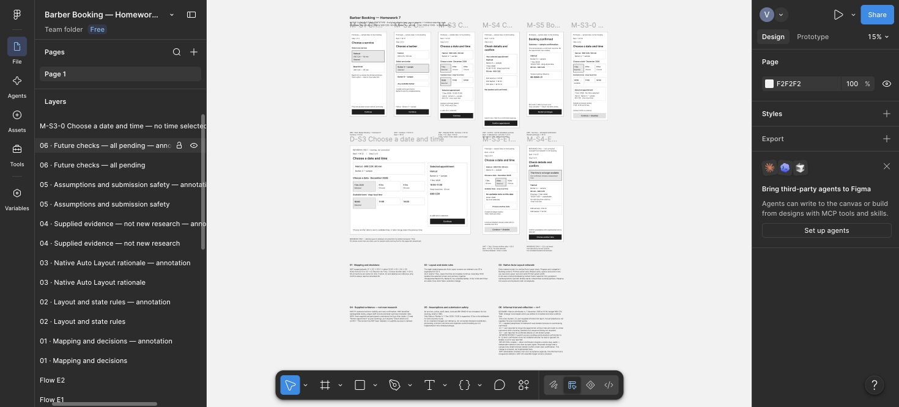
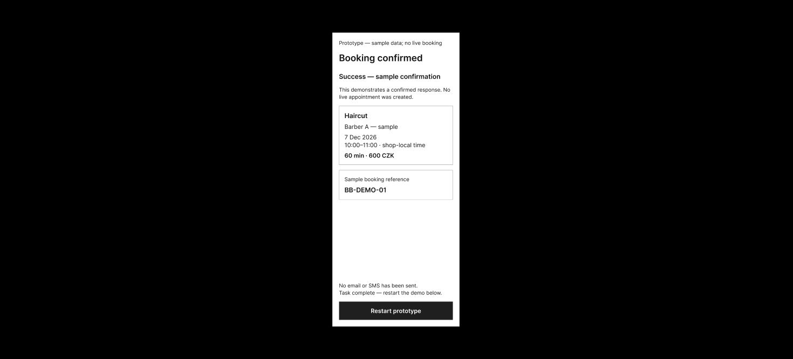
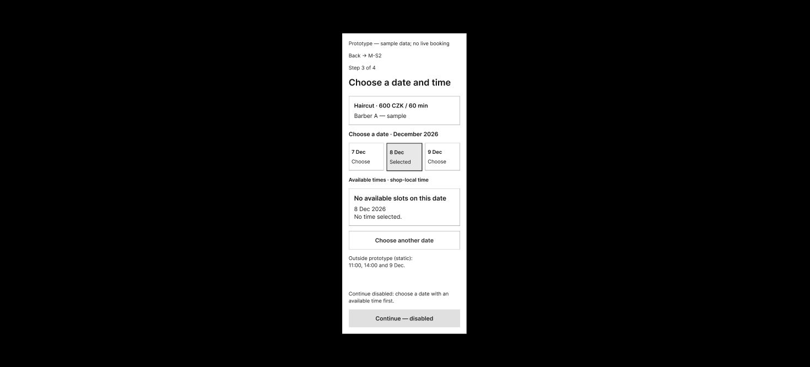

# Homework 7 — Clickable prototype and first feedback

**Status: Complete — official deliverables checked, including one user-reported informal trial with another student. Instructor acceptance is separate.**

- [Separate Figma design file](https://www.figma.com/design/tVuaS2qZ3hUazyXIm6Rpqh/Barber-Booking-%E2%80%94-Homework-7)
- [Start the clickable prototype](https://www.figma.com/proto/tVuaS2qZ3hUazyXIm6Rpqh/Barber-Booking-%E2%80%94-Homework-7?node-id=2-2&scaling=scale-down&content-scaling=fixed&page-id=0%3A1&starting-point-node-id=2%3A2)

## Supported task and start/success

The named flow starts at **M-S1 Choose a service**. Success is **M-S5 Booking confirmed**, with matching sample appointment details and reference. The supported sample is Haircut, 600 CZK / 60 minutes, Barber A — sample, 7 December 2026 at 10:00.

All appointment content is fictional prototype data. No real booking, payment or message is created.

## Native connections

| Source / action | Destination or effect |
| --- | --- |
| S1 Continue | S2 Choose a barber |
| S2 Continue | S3-0 date/time with no selected time |
| S3-0 select 10:00 | S3 date/time with 10:00 selected |
| Selected S3 Continue | S4 Check details and confirm |
| S4 Confirm appointment | S5 Booking confirmed |
| S2 Back | S1 |
| S3/S3-0/E1 Back | S2 |
| S4 Back | Selected S3 |
| S4 Edit service / barber / time | S1 / S2 / S3-0 |
| S3/S3-0 select 8 Dec | E1 No available slots |
| E1 Choose another date or 7 Dec | S3-0; select 10:00 before continuing |
| E1 Continue | Disabled; no navigation reaction |
| S5 Restart prototype | S1; a prototype reset, not a booking function |

Native Instant transitions keep focus on the task. The wiring is checked separately from participant feedback. Technical walkthroughs by the assistant do not count as the required student trial.

## Technical walkthrough — not participant research

Checked in Figma presentation view: S1 Continue → S2 → S3-0; disabled Continue did not change the frame; selecting 10:00 updated the selected time/summary; Continue → S4; Confirm → S5 with matching details/reference; Restart prototype → S1. Also checked 8 Dec → E1, Choose another date → S3-0 with no selected time, and Edit time from S4 → S3-0. The new variant retains native Auto Layout at 390px width. File access shows Anyone can view. These checks are implementation verification only and do not satisfy the other-student trial requirement.

## Known limitations

- One fixed mobile service/barber/date/time branch is implemented.
- Beard trim, Barber B, Any available barber, 11:00, 14:00 and 9 December are static/outside the supported branch.
- Selection persistence and editing are simplified; time editing returns to a no-time-selected state.
- 8 December is a deterministic empty state, not a live availability query.
- E2 and the larger-screen S3 remain visual references outside the regular trial route.
- No backend, live inventory, form input, payment, actual messaging or real booking.
- No randomized submission errors or claimed production validation.
- The prototype is low fidelity. Static alternatives and sample data may affect trial behavior; these limits must be considered when interpreting feedback.
- The unchanged HW1 target (4/5 unaided completion within 60 seconds) remains untested.

## Informal trial scenario and task

**Participant requirement:** At least one other student. The prototype must actually be tried; previous interview/label-check responses cannot substitute for this trial.

**Scenario:** You want a haircut with Barber A on 7 December 2026 at 10:00, with a budget of 600 CZK.

**Task:** Arrange this appointment and tell me when you believe it is booked and which details confirm that.

The task gives a goal and constraints without naming the route, labels or buttons. The moderator should not explain the steps. Observe actions, pauses, backtracking, attempts at static controls and expressed uncertainty.

**Optional separate recovery prompt, after the main task:** What can you do if 8 December has no available appointments?

Do not mix this prompted recovery exploration with spontaneous behavior in the main trial.

## Informal trial — user-supplied evidence, n=1

The student reported that another student tried the prototype. The following records are the student's supplied account, not independent observation by the assistant. No exact recorded participant quotes were supplied. Actual trial date, device, duration and detailed click sequence were not recorded.

| Context | Supplied information |
| --- | --- |
| Participant | Anonymous other student S1 |
| Assistance | The student explicitly reported providing no help |
| Outcome | Participant chose the appointment and recognized success from the confirmation state; no error reported |
| Timing/device | Not supplied; no timing or device claim made |

### Three concrete feedback/observation records

| ID / type | Supplied evidence | Interpretation — separate from evidence |
| --- | --- | --- |
| F1 — feedback paraphrase | Participant believed the appointment was booked because they saw the Booking confirmed state | I1: explicit success wording communicated confirmation to this participant; this is not general usability validation |
| O2 — reported behavior | Student reported the participant chose the appointment without help and made no verbal comments while choosing | I2: this trial did not require moderator intervention; silence alone does not prove absence of uncertainty or reveal the full click sequence |
| O3 — reported behavior | When asked what happened on the Check details and confirm screen, the student reported the participant confirmed directly | I3: direct confirmation does not establish whether the details were read or ignored; no incorrect booking was reported |

“Booking confirmed” names the interface label, not an invented exact participant quotation. The technical walkthrough documented above is not counted as participant research.

## Short reflection

- **Surprising / notable:** The participant confirmed directly despite a separate review step. The report does not explain why or establish whether the details were read.
- **Useful:** The unaided selection and recognition of the explicit success state provide focused first feedback about this supported sample flow.
- **What I would change:** Retain the clear success wording. In a later iteration, test a compact key-detail reminder immediately beside Confirm to make deliberate checking easier. This is an untested improvement proposal, not a proven need or a change implemented after the trial.
- **Limit:** One informal trial with sparse user-supplied notes cannot establish general usability, accessibility, error frequency or the unchanged 4-of-5 under-60-second target.

## Official requirement verification

- [x] Separate Figma file building on the prior wireframes.
- [x] Shareable prototype link.
- [x] Clear start screen and success state.
- [x] Native working main-flow connections and necessary transitions.
- [x] At least one exceptional state reachable: E1 no available slots.
- [x] Known limitations recorded.
- [x] Scenario and goal-based trial task.
- [x] User-reported trial with one other student; the student reported giving no help.
- [x] Three supplied records: F1 confirmation recognition, O2 unaided selection without verbal comments, O3 direct confirmation; interpretations separated and no invented exact quotes.
- [x] Reflection covering notable behavior, useful feedback and a proposed untested improvement.
- [x] Previous homework files preserved.
- [x] Completed repository submission, index/timeline and Done tracking updated.

The supplied trial records and reflection are documented with their limits; the specified Homework 7 deliverables are complete. Instructor acceptance and the course's attendance, final-project and written-test requirements remain separate.

## Official sources

Homework — Clickable prototype and first feedback; Interaction and prototype; Course Repository; Assessment and Grading System project-source PDFs. [Official Homework 7 page](https://pte-mik.github.io/info/ux-ui-en/content/07/07-00-homework/).

## Prototype preview

