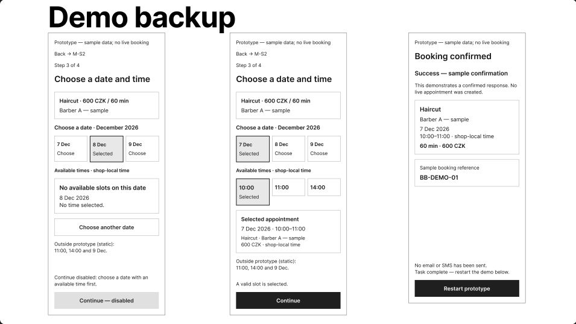

<!--@slide 1 · Booking without waiting-->
# Booking without waiting

Barber Booking · Volkan Gulsoy · C09332
Make availability visible before booking.
A focused UX concept, not a live service.
Evidence: HW1 brief; HW2 interview (n=1).

<!-- Speaker notes: 00:00–00:40. Introduce the task: arrange one haircut, know price/time and recognize confirmation. I chose it because the interview exposed reply-dependent availability. One account does not establish a market-wide problem. -->

---

<!--@slide 2 · Waiting was the friction-->
# Waiting was the friction

One returning customer booked through Instagram.
They waited for replies and accepted another time.
They trusted the barber; the booking still worked.
Evidence: HW2, O4–O7. One retrospective account.

<!-- Speaker notes: 00:40–01:20. Explain that the participant could not view slots independently. The main finding was coordination delay, not a failed booking. Familiarity and trust were strengths. This is not evidence that all customers have severe difficulties. -->

---

<!--@slide 3 · Design for one journey-->
# Design for one journey

Persona: a returning customer who knows the barber.
Need haircut → ask → negotiate time → confirm.
Opportunity: visible slots and retrievable details.
Evidence: HW2 persona/journey, derived from P1.

<!-- Speaker notes: 01:20–02:00. Describe the persona's goal, knowledge, constraint and risk. Approximate prices were already familiar; availability depended on replies. Feelings not reported at particular journey steps remain unknown. No invented demographics. -->

---

<!--@slide 4 · Keep the task focused-->
# Keep the task focused

Service → barber → date/time → review → success.
Show price, duration and available alternatives.
Defer accounts, payment and notifications.
Evidence: HW4 eight ideas; HW5 inventory and flow.

<!-- Speaker notes: 02:00–02:45. Explain the chosen direction and trade-off. Visible availability addresses the research account; a summary preserves clarity. Reminders and accounts add operational assumptions without strong evidence. HW3 audit also motivates named controls, honest states and synchronized summaries. -->

---

<!--@slide 5 · Make review unambiguous-->
# Make review unambiguous

One of three label-check participants interpreted
Review appointment as possibly past bookings.
Changed to Check details and confirm.
Evidence: HW5 P2. Revised wording was not retested.

<!-- Speaker notes: 02:45–03:20. State the actual label-check lesson. Two understood the intended meaning; one was uncertain. This justified a wording change, not a claim of a measured improvement. The sitemap and flow keep review distinct from confirmation. -->

---

<!--@slide 6 · Completion is preliminary-->
# Completion is preliminary

HW8: three people reportedly finished both tasks
without help and recognized confirmation.
No unusual behavior was reported.
Timing and full detail recall were not recorded.

<!-- Speaker notes: 03:20–04:05. Consent and completion were reported by the student. Notes are brief and second-hand, with no exact quotations or detailed action traces. Do not infer zero errors. HW7's one-student trial also reported direct confirmation; this does not prove details were ignored. -->

---

<!--@slide 7 · Refine, then standardize-->
# Refine, then standardize

HW8 added a five-detail review reminder.
HW9 defined reusable button/date-input states
and a developer handoff with named variables.
Rationale: evidence gaps; no proven user benefit yet.

<!-- Speaker notes: 04:05–04:50. Name the reminder: check service, barber, date, time and price. Describe three HW9 iterations: action-state components, a visible focus specimen and explicit invalid-date rules. They address structure and coverage gaps, not invented usability failures. Date input is the existing segmented calendar control. -->

---

<!--@slide 8 · Separate checks from proof-->
# Separate checks from proof

Design check: 2px focus outline, 17.40:1 on white.
Passes its ≥2px / ≥3:1 design criterion.
Original target: 4/5 unaided within 60 seconds.
That target remains unverified. Evidence: HW1, HW9.

<!-- Speaker notes: 04:50–05:30. Explain measured technical evidence versus human outcomes. Figma inspection verified a 2px stroke and the contrast was calculated from sRGB luminance. This is not a keyboard user test, whole-interface accessibility claim or speed result. Three untimed reports cannot establish the original target. -->

---

<!--@slide 9 · Demo the recovery decision-->
# Demo the recovery decision

Choose 8 Dec → no slots → choose another date.
Select 7 Dec, 10:00 → review → confirm.
Final prototype: figma.com/proto/R2lUWTNhtN1qjitk6AM9LK
Backup: sample states on the following slide.

<!-- Speaker notes: 05:30–06:25. Open the final HW9 prototype linked in the submission. Start from service and barber, then deliberately choose 8 December to demonstrate honest unavailability and safe recovery. Select 7 December at 10:00; confirm the review details and explicit success. Keep demo under 55 seconds. If Figma fails, use the following backup states. Do not submit a real booking. -->

---

<!--@slide 10 · Demo backup-->
# Demo backup

Left: no slots. Middle: recovered valid selection. Right: explicit confirmation.

Source: static copies of the final HW9 screens; not research or a new test.

<!-- Speaker notes: Use instead of the live demo if the prototype is unavailable. Explain no slots → choose another date → select 10:00 → review → confirm. Never imply a real appointment was created. -->

---

<!--@slide 11 · Strong evidence has limits-->
# Strong evidence has limits

Strongest: a concrete past booking account;
reported trials support basic completion only.
No backend; other services/times remain static.
Next: record time/detail recall and test keyboard use.

<!-- Speaker notes: 06:25–07:10, after a brief backup-state view if needed. Reflect: tracing a real past event to a narrow design decision is stronger than treating a product preference as validation. I would recruit enough relevant users to measure the original target, record detail recall, and test focus and recovery in a keyboard-enabled implementation. Present-day evidence cannot prove adoption or operational availability. -->